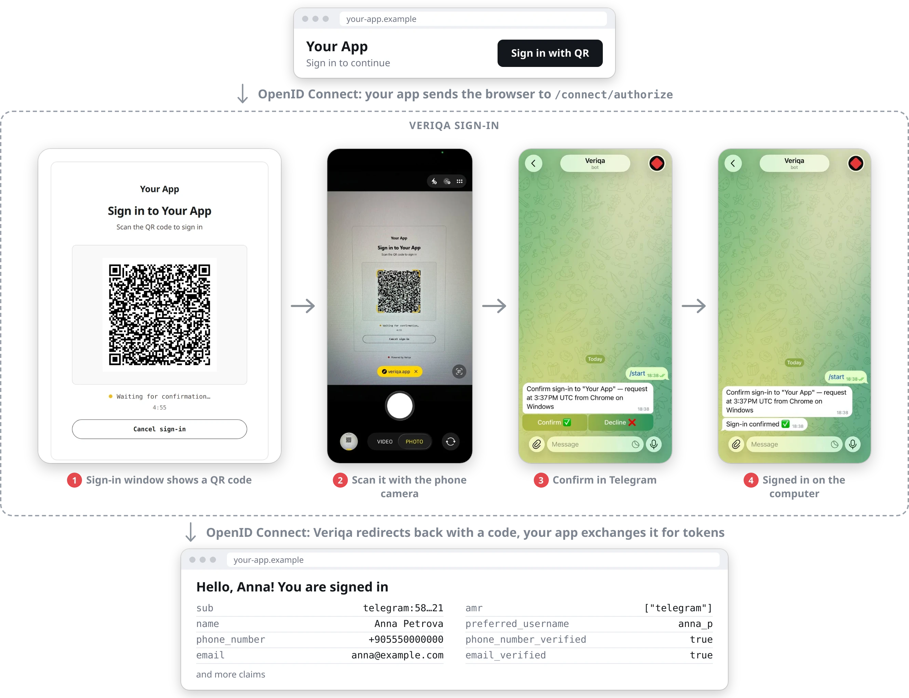
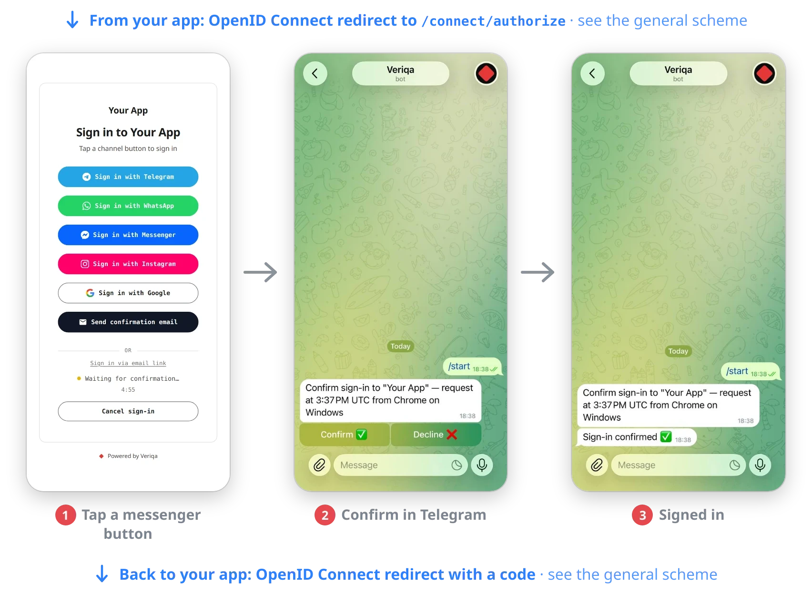

# Telegram login for Python, Node.js, Go, PHP and ASP.NET Core — passwordless Telegram authentication over OpenID Connect (OIDC)

Sign in with Telegram for a Python, Node.js, Go, PHP or ASP.NET Core app, with no password: QR code login instead of a password or an SMS
code. Your users scan the QR code on the sign-in page (on a phone, they tap a button) and confirm in Telegram.

The example is a standard OpenID Connect (OIDC) provider plus a minimal client app in each of these languages. Login with Telegram works the same way on any other stack with an OIDC library.

<p align="center">
  <br />
  <sub>On a computer: a QR code, the phone camera, one tap in Telegram.</sub>
</p>

<p align="center">
  <br />
  <sub>On a phone: a channel button, one tap in Telegram. The screenshot is from a demo with every channel on; this stand offers only Telegram.</sub>
</p>

## What you get

Open the client app and it sends you to the sign-in page. On a computer you scan the QR code with
your phone; on the phone itself you tap a button. Telegram opens your bot, you confirm with one tap
— and you are back in the app, signed in, looking at the claims the provider issued. No password,
no form, no SMS code.

The provider is [Veriqa](https://veriqa.app): an open-source OpenID Connect provider built on
OpenIddict that confirms sign-ins in messaging apps — Telegram, WhatsApp, Instagram, Messenger,
WeChat, Viber, other channels or Email. The clients know nothing about Veriqa: each one uses a stock OpenID
Connect library for its language (Authorization Code + PKCE), so the same setup works for any stack
with an OIDC library.

Each folder next to `clients/` is one way to connect Telegram, with a stand of its own; they share the client apps
in `clients/`. `built-in/` uses the Telegram channel built into Veriqa.

```
built-in/            the stand with the Telegram channel built into Veriqa
  docker-compose.yml   Veriqa from the published image, Telegram channel only
  .env.example         the values you fill in
clients/             the client app, one per language - run any of them
  python/              Flask, Authlib
  node/                Express, openid-client, in TypeScript
  go/                  net/http, go-oidc
  php/                 jumbojett/openid-connect-php
  dotnet/              ASP.NET Core, Microsoft.AspNetCore.Authentication.OpenIdConnect
```

## Before you start

- [Docker](https://docs.docker.com/get-docker/) with Compose: the stand runs in it for simplicity. Veriqa also runs
  without Docker, [as an OS service](https://veriqa.app/docs/quickstart/os-service)
- the runtime of the client you pick: Python 3.10+, Node.js 24.5+, Go 1.26+, PHP 8.2+ with
  [Composer](https://getcomposer.org/), or the [.NET SDK 10](https://dotnet.microsoft.com/download)
- a Telegram bot: create one with [@BotFather](https://t.me/BotFather) and keep its token. Use a
  bot no other server is polling — Telegram hands the updates to one poller only.

No public address is needed: the stand runs Telegram in polling mode, the bot fetches its updates
itself.

## Run it

**1. Fill in the settings.**

```bash
cd built-in
cp .env.example .env
```

Put your bot token into `TELEGRAM_BOT_TOKEN` and pick any password for `CERT_PASSWORD`.

**2. Create the HTTPS certificate.** OpenID Connect needs HTTPS even locally: the provider serves
it at `https://localhost:8443`.

For the Python, Node.js, Go and PHP clients, let the stand create a self-signed certificate:

```bash
docker compose run --rm certificate
```

The clients find it in `certs/` on their own. Your browser warns about it when the sign-in page first
opens: choose to proceed.

For the ASP.NET Core client, use the .NET development certificate, which also serves the client at
`https://localhost:7020`:

```bash
dotnet dev-certs https --trust
dotnet dev-certs https -ep certs/localhost.pfx -p <CERT_PASSWORD from .env>
chmod 644 certs/localhost.pfx
```

`--trust` makes your machine trust the certificate; on Linux follow what the command prints. The
`chmod` (Linux and macOS) lets the non-root user of the container read the file; on Windows skip it
and write the path as `certs\localhost.pfx`.

The stand holds one certificate at a time. To switch between the two kinds, delete `certs/` first (with
`sudo` on Linux, the container created it) and create the provider again with `docker compose up -d --force-recreate`.

**3. Start the provider.**

```bash
docker compose up -d
docker compose ps
```

Wait until the status reads `healthy`, then check that it is ready:
`https://localhost:8443/health/ready` answers `200`.

**4. Start the client.**

Python:

```bash
cd ../clients/python
python3 -m venv .venv
.venv/bin/pip install -r requirements.txt
.venv/bin/python main.py
```

On Windows, run `python -m venv .venv`; the virtual environment's programs are in `.venv\Scripts\`.

Node.js:

```bash
cd ../clients/node
npm install
npm start
```

Go:

```bash
cd ../clients/go
go run .
```

PHP:

```bash
cd ../clients/php
composer install
php -S localhost:7020 index.php
```

ASP.NET Core:

```bash
dotnet run --project ../clients/dotnet -- --Oidc:Channel telegram
```

**5. Sign in.** Open `http://localhost:7020` (`https://` for the ASP.NET Core client), scan the QR code with your phone and confirm in
Telegram. You land back on the client with the list of your claims. `/signout` drops the local
session so you can go again.

## How it fits together

- `clients/dotnet/` asks the provider for a sign-in with `acr_values=channel:telegram`, so the sign-in page goes
  straight to Telegram. Without `--Oidc:Channel` it offers every enabled channel. The
  other clients take the same value from the `VERIQA_CHANNEL` variable; this stand enables one channel,
  so they run without it.
- `built-in/docker-compose.yml` registers the client (`rp`, redirects `http://localhost:7020/signin-oidc`
  and `https://localhost:7020/signin-oidc`), sets the issuer to `https://localhost:8443` and enables the
  Telegram channel.
- The stand runs in the `Development` environment: sessions live in memory and tokens are signed
  with development certificates, so a restart forgets everything. That is what makes it one
  container — it is a local stand, not a deployment.

## Going further

- Telegram channel settings, including the webhook mode for a deployed server:
  [Channels → Telegram](https://veriqa.app/docs/guides/channels#telegram).
- A production setup with a database, real certificates and a reverse proxy:
  [Quickstart self-hosted](https://veriqa.app/docs/quickstart/self-hosted).
- Veriqa itself — the source, the other samples and the documentation:
  [gitlab.com/veriqa/veriqa](https://gitlab.com/veriqa/veriqa) · [veriqa.app](https://veriqa.app).

## License

This sample is MIT-licensed — copy it into your own code freely. Veriqa itself is open source under
MPL-2.0.
